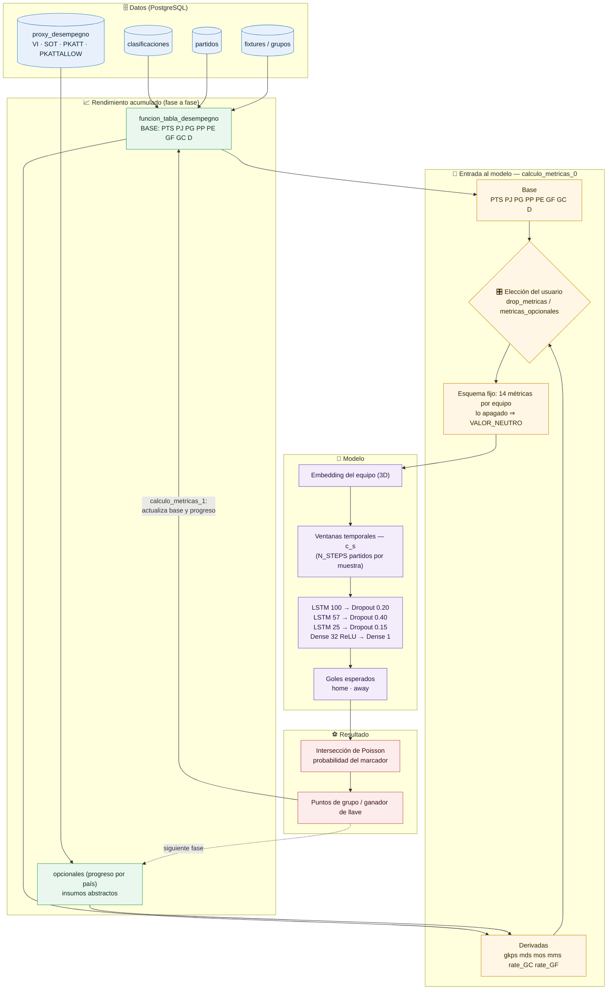
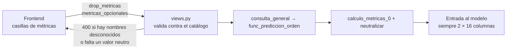
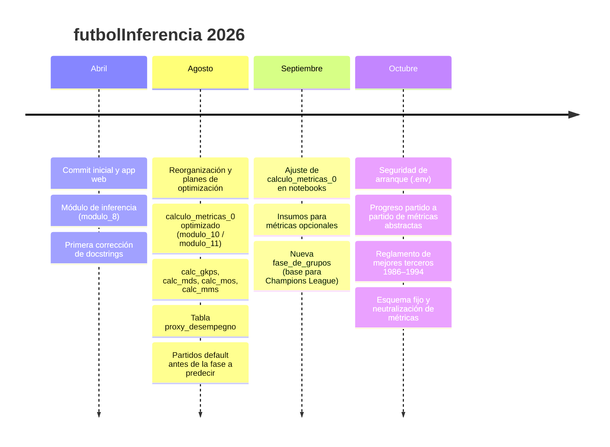

# futbolInferencia

Predicción de resultados de los Mundiales de fútbol (1934 – 2022) con un modelo de **series temporales (LSTM)**. Una aplicación web en Django deja al usuario elegir un mundial y una fase, modificar los partidos que quiera y simular el resto del torneo partido a partido. El modelo recibe el rendimiento acumulado de cada selección y lo actualiza tras cada predicción.

---

## Objetivos

### Objetivo general
Construir un sistema que **simule un Mundial completo** a partir de cualquier fase elegida por el usuario: predice los goles de cada partido con una red LSTM y propaga el rendimiento de cada selección de una fase a la siguiente.

### Objetivos específicos
1. **Datos:** reunir partidos, fixtures, grupos y eliminatorias de todos los mundiales en PostgreSQL (scraping en `scripts/activos/`).
2. **Rendimiento base:** acumular por selección, partido a partido, las métricas `PTS PJ PG PP PE GF GC D` desde las eliminatorias previas hasta la fase en curso.
3. **Rendimiento derivado:** calcular métricas opcionales (`gkps mds mos mms rate_GC rate_GF`) a partir de insumos abstractos (`VI SOT PKATT PKATTALLOW`) que también avanzan partido a partido.
4. **Inferencia secuencial:** alimentar la LSTM con ventanas temporales de partidos (embedding del equipo + métricas) y convertir los goles predichos en resultados mediante la intersección de probabilidades de Poisson.
5. **Formatos de torneo:** respetar cada formato histórico (eliminación directa en 1934/38, fase final de grupos en 1950, mejores terceros en 1986 – 1994, octavos desde 1998).
6. **Control del usuario:** dejar elegir desde el frontend qué métricas base descartar y qué métricas opcionales usar, **sin cambiar las dimensiones** de la entrada al modelo.
7. **Escalabilidad:** preparar la lógica de fases para otros torneos (Champions League, Copa Libertadores).

---

## Cómo funciona la IA de series temporales



**La idea central:** cada partido simulado modifica el rendimiento de las dos selecciones, y ese rendimiento es la serie temporal que ve el modelo en el partido siguiente. Así el torneo se predice como una secuencia, no como partidos aislados.

### Neutralización de métricas (control del usuario)



- **Base descartada** (`drop_metricas`): su columna llega al modelo con `VALOR_NEUTRO`, pero se sigue acumulando en la simulación.
- **Opcional no aceptada** (no figura en `metricas_opcionales`): su columna llega con `VALOR_NEUTRO`.
- Ninguna columna se quita ni se añade, así que el modelo recibe siempre las mismas dimensiones.

---

## Estructura del proyecto

```
futbolInferencia/
├── data/                     # datos y modelos entrenados (fuera de git)
├── scripts/
│   ├── activos/              # scraping, limpieza y notebook de entrenamiento
│   └── pruebas/              # prototipos y notas de avance (avances.py)
└── web/                      # aplicación Django
    ├── mundial/              # settings (lee .env con python-decouple)
    └── fases/
        ├── models.py         # partidos, fixtures, grupos, clasificaciones, proxy_desempegno
        ├── modulo.py         # métricas, features, inferencia y reglamentos de mejores terceros
        ├── views.py          # endpoints: procesar_recepcion_0 (página) y _1 (predecir)
        └── templates/prediccion_2.html
```

## Puesta en marcha

1. Copiar `web/.env.example` a `web/.env` y completar `SECRET_KEY`, `DEBUG`, `ALLOWED_HOSTS`, `DB_NAME`, `DB_USER`, `DB_PASSWORD`, `DB_HOST` y `DB_PORT`.
2. `cd web && python manage.py migrate` (crea también la tabla `proxy_desempegno`).
3. Cargar los datos en las tablas, incluida `proxy_desempegno` con su columna `pais`.
4. `python manage.py runserver`.

> `modulo.py` consulta la base de datos al importarse (arma `dic_agnos`), así que Django necesita la BD disponible incluso para `makemigrations`.

**Stack:** Python · Django · PostgreSQL · TensorFlow/Keras · pandas · NumPy · SciPy · JavaScript (fetch).

---

## Historia del proyecto



| Fecha | Cambio |
|---|---|
| 2026-04-12 | Commit inicial, primera versión y app web. |
| 2026-04-13 / 19 | Ajustes a `modulo_8.py` y primera ronda de docstrings. |
| 2026-08-10 / 11 | Estructura y planes de optimización; se retira data innecesaria. |
| 2026-08-15 | `modulo_10.py`: `calculo_metricas_0` pensado para el máximo de métricas de rendimiento. |
| 2026-08-29 | Funciones `calc_gkps`, `calc_mds`, `calc_mos` y `calc_mms`; modelo `proxy_desempegno`. |
| 2026-08-30 | `fase_de_grupos` y `jugar` aceptan resultados default antes de la fase a predecir; `modulo_11.py`. |
| 2026-09-02 / 05 | Notebooks para ajustar `calculo_metricas_0`; propuestas para `funcion_tabla_desempegno`. |
| 2026-09-27 / 10-01 | Insumos para métricas opcionales; refactor para escalabilidad; nueva `fase_de_grupos`. |
| 2026-10-07 | Rama `fix/seguridad-arranque`: settings con `.env`; se dejan de versionar datos y notebooks. |
| 2026-10-11 | `funcion_tabla_desempegno` y `calculo_metricas_1` avanzan el progreso de las abstractas partido a partido. |
| 2026-10-12 | Reglamento de mejores terceros 1986 – 1994 (oficial o personalizado desde el frontend). |
| 2026-10-12 | **Esquema fijo de entrada y neutralización de métricas**: `BASE_METRICS` + `OPTIONAL_METRICS` = 14 por equipo; descarte y elección de métricas desde el frontend; histórico abstracto por id de país; métricas derivadas calculadas por partido; migración de `proxy_desempegno`. |

---

## Pendientes conocidos

- **Reentrenar el modelo** con el esquema de `ALL_METRICS` (14 métricas por equipo, mismo orden y misma `calculo_metricas_0`). El `.h5` actual (diciembre de 2024) se entrenó con 10 features por paso.
- **`VALOR_NEUTRO`:** rellenarlo con la media de cada columna de `X_tr`. Hasta entonces el servidor rechaza (400) cualquier intento de descartar métricas o de no usar alguna opcional.
- **PJ histórico en `proxy_desempegno`:** VI, SOT y PKATT son totales históricos, y sin su PJ los promedios se calculan como si fueran un solo partido.
- **`N_STEPS`:** vale 0 en `modulo.py`, pero el entrenamiento usó ventanas de 5 partidos.
- **Estado global:** `opcionales` se reinicia en cada consulta, pero dos consultas simultáneas en un servidor con varios hilos lo compartirían. Habría que moverlo dentro del objeto de predicción.
- **Ruta del modelo** fija en `consulta_general`: llevarla a `.env`.
- Adaptación a Champions League y Copa Libertadores.
