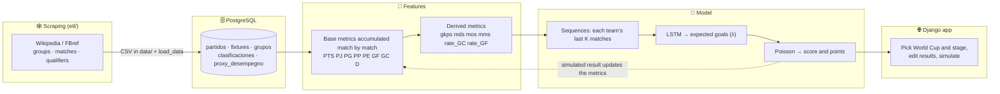
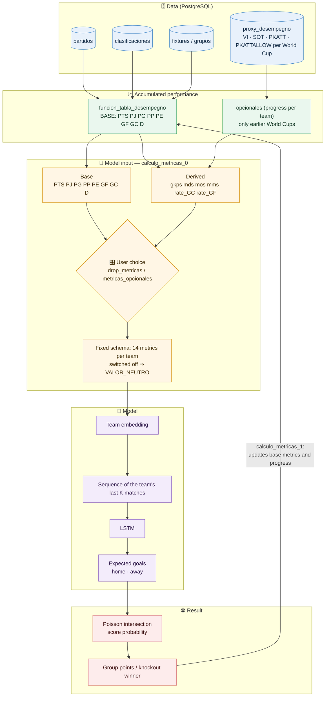
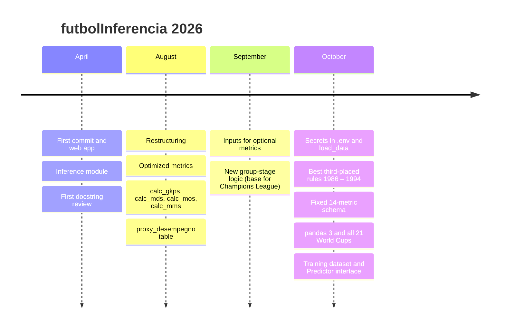

# futbolInferencia

**Simulate any FIFA World Cup (1930 – 2022) from any stage: change the results you want and a time-series model predicts the rest of the tournament, match by match.**

<!-- TODO (Phase 5): 15-second GIF of the "what if…?" mode, e.g.  -->


> **Status (October 2026):** the data pipeline, the tournament simulation for all 21 World Cups and the training dataset are working. The LSTM is being retrained for the new 14-metric input; until then the app predicts with a baseline (average goals of home and away teams, so every simulated match ends 1:1) and only from the group stage. See [Roadmap](#roadmap).

---

## What it does

- Lets the user pick a World Cup and a stage, edit any match result and simulate the rest of the tournament.
- Respects every historical format: straight knockout (1934/38), final group round (1950), second group stage (1974 – 82), best third-placed teams (1986 – 94), round of 16 (1998 – 2022).
- Each team carries its performance (points, wins, goals, defensive/offensive scores…) from the qualifiers into the tournament and updates it after every match, so the model sees the tournament as a **sequence**, not as isolated matches.
- Predicted goals are turned into results with a Poisson model.

**Stack:** Python 3.12 · Django 6 · PostgreSQL · TensorFlow/Keras · pandas · NumPy · SciPy · Selenium (scraping) · JavaScript (fetch).

---

## Architecture



### How the time-series model sees a tournament



**No data leakage:** every training row only contains information from *before* that match, and the shots/penalty history of a World Cup only adds up earlier World Cups.

**User control without changing the model input:** a discarded base metric or a rejected optional metric reaches the model with its `VALOR_NEUTRO`; no column is ever added or removed, so the model always receives the same shape.

**Framework-agnostic predictions:** the simulation only needs expected goals per match. Any model that implements `Predictor` (`web/fases/predictores.py`) can be plugged in: Keras, scikit-learn, a time-series foundation model… Each trained model is saved with an `esquema.json`, and the app refuses to load a model trained with different metrics.

---

## Project structure

```
futbolInferencia/
├── data/                       # versioned inputs (CSV + model); datasets/ is generated, not versioned
│   ├── partidos/  grupos/      # matches, fixtures, qualifiers and group tables
│   ├── proxy_desempegno/       # shots / clean sheets / penalties per World Cup (scraped)
│   └── modelos/                # trained models
├── etl/                        # scraping and data cleaning (busca_grupos.py --anio 1986, busca_metricas.py…)
├── notebooks/                  # training notebook (2024) and metric tuning
├── experimentos/               # prototypes and the 2026 re-download study (redescarga/)
├── web/                        # Django project
│   ├── mundial/                # settings (reads .env with python-decouple)
│   └── fases/
│       ├── models.py           # partidos, fixtures, grupos, clasificaciones, proxy_desempegno
│       ├── modulo.py           # metrics, tournament simulation, best-third-placed rules, inference
│       ├── dataset.py          # training dataset and per-team sequences
│       ├── predictores.py      # Predictor interface, baseline and model loading
│       ├── views.py            # page and /procesar_recepcion_1/ (predict)
│       ├── management/commands # load_data, construir_dataset
│       ├── templates/prediccion_2.html
│       └── tests.py
├── requirements.txt            # web app
└── requirements-dev.txt        # + notebooks, training and scraping
```

---

## Installation

Requirements: **Python 3.12**, **PostgreSQL 14+** and Git. Commands are shown for Windows PowerShell; on Linux/macOS use `source .venv/bin/activate` and `python3`.

**1. Clone and create the virtual environment**

```powershell
git clone https://github.com/Kozuki-4i-9/futbolInferencia.git
cd futbolInferencia
python -m venv .venv
.venv\Scripts\Activate.ps1
python -m pip install -r requirements.txt        # or requirements-dev.txt for notebooks and scraping
```

**2. Create the database** (in `psql` as the `postgres` user)

```sql
CREATE USER mundial WITH PASSWORD 'choose-a-password';
CREATE DATABASE bd_mundial OWNER mundial ENCODING 'UTF8' TEMPLATE template0;
```

**3. Configure the environment**

```powershell
copy web\.env.example web\.env
python -c "from django.core.management.utils import get_random_secret_key as k; print(k())"
```

Edit `web/.env`: paste the generated key in `SECRET_KEY` and the password from step 2 in `DB_PASSWORD`. The other values work as they are for a local install.

**4. Create the tables and load the data**

```powershell
cd web
python manage.py migrate
python manage.py load_data          # loads the CSV files in data/ (use --reemplazar to reload)
```

**5. Run**

```powershell
python manage.py runserver
```

Open http://127.0.0.1:8000.

**Tests**

```powershell
python manage.py test fases
```

**Optional commands**

| Command | What it does |
|---|---|
| `python manage.py construir_dataset` | Builds `data/datasets/partidos_features.csv` (≈ 8,800 matches, takes a few minutes) for training |
| `python manage.py entrenar_predictor` | Retrains the baseline predictor from that file into `data/modelos/medias/` (`--hasta 2010` to leave later World Cups out) |
| `python etl/busca_grupos.py --anio 1986` | Downloads a World Cup's group tables from Wikipedia (`--todos` for all; needs Firefox and `requirements-dev.txt`) |

---

## Data collection: lessons from scraping Wikipedia

**How it started.** Group tables were scraped from Spanish Wikipedia with Selenium, **one script per World Cup** (`busca_grupos_1930.py` … `busca_grupos_2022.py`, still in the git history). Each page had its own quirks, so each script hard-coded them: the table's inline `style`, whether the group title was an `h3` or an `h4`, which tables to skip (`[1:]`, `[4:]`, `[:-1]`), the position of the title in a list, and machine-specific paths to `geckodriver.exe`.

**What broke.** Wikipedia later changed its HTML (titles moved from `<span id>` to `<h3 id>` inside `div.mw-heading`, modern tables changed style). Several scripts silently stopped finding anything — the 1986 one among them. Twenty copies of almost the same code also meant twenty places to fix.

**How it works now.** `etl/busca_grupos.py` uses **one rule for every year, based on content instead of layout**: a group table is a table whose header has a `Pts` column and that links to national teams; its name is the closest previous heading whose id starts with `Grupo_` (anything else, such as *Statistics* or the 1950 final round, is skipped). Validated against the 20 existing CSV files: all 20 identical. A full re-download (`experimentos/redescarga/`) also found that the old match scraper stored **penalty shoot-out scores as match scores** (35 knockout matches, e.g. the 2022 final as 4:2 instead of 3:3) and a 1938 match that was never played; both are pending correction before retraining.

**Advice for the future**
- Select by **meaning** (column names, heading ids, link titles), never by inline styles or positions.
- **Validate every scraper against known data** (a previous download or a second source) before trusting it; scrapers fail silently.
- **Keep raw values apart from derived ones**: score, extra time and penalties in separate columns.
- **One parametrised script plus a small exceptions table** beats one script per case; let Selenium Manager find the browser driver instead of hard-coding paths.
- Keep the raw downloads (`data/redescarga/`) so a study can be repeated without hitting the site again, and respect the site: one request per page, no parallel crawling.

---

## Model results

<!-- Filled in by the evaluation (Phase 2): train ≤ 2010, validate 2014, test 2018 + 2022 -->

| Model | Goals MAE | Correct outcome (W/D/L) | Exact score |
|---|---|---|---|
| Always the team with more historical points | – | – | – |
| Poisson with average goals | – | – | – |
| Always 1-1 | – | – | – |
| **LSTM (14 metrics, sequences of 5 matches)** | – | – | – |

---

## Roadmap

- [x] Secrets out of the code, reproducible database (`load_data`), all 21 World Cups simulated end to end
- [x] Training dataset without leakage and per-team sequences
- [ ] Evaluation notebook against baselines (fills the table above)
- [x] Connect the app to `cargar_predictor` (baseline `PredictorMedias` in `data/modelos/medias/`)
- [ ] Retrain the LSTM with the 14-metric schema
- [ ] Simulate from any stage, not only from the first one
- [ ] 2026 format (48 teams, 12 groups, 8 best third-placed teams)
- [ ] Shots and penalties data per World Cup (`proxy_desempegno`)
- [ ] Split `modulo.py` into smaller modules with tests
- [ ] Docker, public demo and CI
- [ ] Natural-language explanations of each prediction (LLM)

<details>
<summary>Project history</summary>



</details>

---

## Resumen en español

**futbolInferencia** simula cualquier Mundial (1930 – 2022) desde la fase que elijas: cambias los resultados que quieras y un modelo de series temporales (LSTM) predice el resto del torneo partido a partido. Cada selección arrastra su rendimiento desde las eliminatorias y lo actualiza tras cada partido; los goles predichos se convierten en resultados con un modelo de Poisson.

**Estado:** los datos, la simulación de los 21 Mundiales y el dataset de entrenamiento funcionan. El modelo se está reentrenando con las 14 métricas nuevas; hasta entonces la web abre pero no devuelve predicciones.

**Scraping:** empezó con un script de Selenium por Mundial, adaptado a cada página; cuando Wikipedia cambió su HTML varios dejaron de funcionar. Hoy un solo script (`etl/busca_grupos.py`) usa una regla basada en el contenido (columna «Pts» y título «Grupo…») y reproduce los 20 Mundiales. Detalles y lecciones en *Data collection* (arriba).

**Instalación rápida:** Python 3.12 y PostgreSQL → `pip install -r requirements.txt` → crear la base y el usuario (paso 2) → copiar `web/.env.example` a `web/.env` y completarlo → `python manage.py migrate` → `python manage.py load_data` → `python manage.py runserver`.
